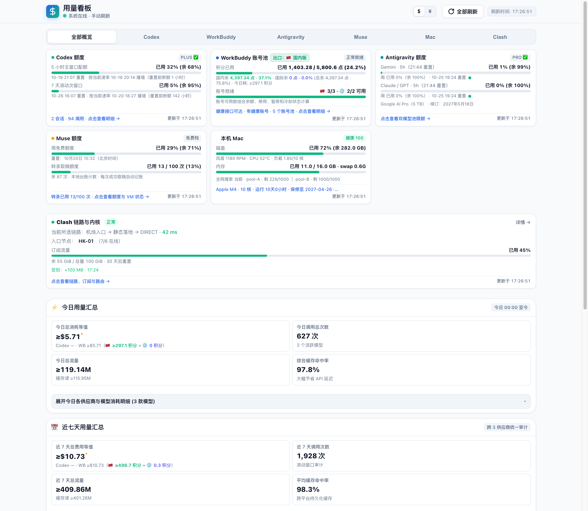

# 本地用量看板 · Local Usage Dashboard

一个把多个 AI 订阅/额度数据源汇总到单页的本地看板。纯静态前端 + 标准库 HTTP 服务，无框架、无 CDN、无构建步骤。

> 本仓库是**演示版**：前端与接口契约和线上版本一致，数据采集层换成了 `fixtures/` 里的示例 JSON。所有账号、金额、时间均为虚构。



## 它解决什么问题

同时用多个 AI 订阅（Codex、WorkBuddy、Antigravity、Muse……）时，每家的额度、重置时间、积分余额都散在不同地方。这个看板的做法是：**每个数据源写一个采集脚本，统一输出 JSON，前端只认 JSON**。于是新增一家供应商只需要加一个脚本和一张卡，页面结构不用动。

## 设计思路

**1. 采集与展示彻底分离**

每个数据源是一个独立脚本，`--json` 输出固定结构；服务端不解析业务字段，只负责执行、缓存和转发。脚本可以随时用命令行单独跑、单独测，不依赖网页。

**2. 服务端只做三件事**

- 执行采集命令（超时、失败归类，不把 stderr 原文透给前端）
- 缓存：90 秒 TTL + stale-while-revalidate + single-flight（同一个源同时只有一个刷新在跑）
- 脱敏：对外接口剥掉 uid、原始昵称、凭据路径

**3. 前端零依赖**

没有 React/Vue，没有打包。`index.html` 直接引 `pure.js`（纯函数）和 `app.js`（装配）。纯函数抽出来是为了能用 `node tests/test_pure.js` 直接测——时间格式化、百分比、阈值判定这些最容易出错的逻辑都在里面。

**4. 契约优先**

新增一个数据源只改三处：

```
server.py  COMMANDS 加一条命令
app.js     keys 数组加一个 key
app.js     renderData 加一个渲染分支（+ index.html 一张卡）
```

字段改名或删字段才需要动前端；只加字段不动前端也能跑（页面显示 `—`，不报错）。

## 架构

```
             ┌──────────────┐
  provider A │ collector.py │──┐
  provider B │ collector.py │──┼──> JSON ──> server.py ──> /api/<key> ──> app.js
  local host │ collector.py │──┘             (TTL/SWR)                    (render)
             └──────────────┘
```

线上版的 `server.py` 通过 `subprocess` 调这些脚本；演示版的 `mock_server.py` 直接把 `fixtures/<source>.json` 当成脚本输出返回，响应契约完全相同。

## 快速开始

```bash
python3 mock_server.py            # 默认 127.0.0.1:8000
# 打开 http://127.0.0.1:8000
```

只需要 Python 3.9+，无第三方依赖。

指定端口：

```bash
python3 mock_server.py --port 8080
```

## 接口契约

所有数据接口统一返回：

```json
{
  "meta": {
    "ok": true,
    "fetched_at": "2026-10-19T17:24:05+08:00",
    "from_cache": false,
    "age_seconds": 0,
    "stale": false,
    "refresh_pending": false
  },
  "data": { }
}
```

`meta` 是前端判定"这块数据新不新鲜"的唯一依据：

- `stale` / `refresh_pending` → 显示「更新中」
- 请求失败 → 有旧数据显示「更新于 HH:MM:SS（刷新失败）」，无旧数据显示「更新失败」
- 其余 → 「更新于 HH:MM:SS」

### 数据源

| key | 内容 | 采集方式（线上版） |
|---|---|---|
| `codex` | Codex 额度窗口、逐实例用量、API 等值 | 本地 rollout 记录 + 官方 usage 接口 |
| `wb` | WorkBuddy 账号池、积分、兑换价 | 网关内存接口 + 积分快照 |
| `agy` | Antigravity 双模型池额度 | CLI `/usage` 只读 |
| `muse` | Muse 周额度、转录次数、VM 状态 | 本地桥查询 |
| `tavily` | 搜索 key 池剩余量 | 各 key `/usage` |
| `mac` | 磁盘、内存、风扇、温度、负载 | `df` + 传感器本地接口 |
| `anchors` | 窗口保活状态 | 读保活脚本的 state 文件 |
| `clash` | 代理链路、订阅配额、路由观察 | 本地 Unix socket 只读 |
| `wb-throttles` | 实时 429 冷却（不进缓存） | 网关账号接口 |

## 接自己的数据源

1. 写一个脚本，`--json` 输出任意结构，保证是合法 JSON
2. 把它加进 `server.py` 的 `COMMANDS`（演示版：把 JSON 放进 `fixtures/` 并在 `mock_server.py` 的 `SOURCES` 注册）
3. 在 `app.js` 的 `keys` 数组加 key，在 `renderData` 加渲染分支
4. 在 `index.html` 加分段按钮、`#view-<key>` 容器和预览卡

如果只是替换现有数据源，改 `fixtures/*.json` 就行，前端不用动。

## 目录

```
.
├── index.html          页面结构（分段导航 + 预览卡 + 详情视图）
├── app.css             样式（含响应式与深色模式）
├── pure.js             纯函数：时间、百分比、阈值、文案判定
├── app.js              装配层：取数、渲染、视图切换
├── mock_server.py      演示服务：静态文件 + fixtures 回放
├── fixtures/           示例数据（账号A–E，金额与时间均为虚构）
└── docs/               截图
```

线上版另有约 2,900 行测试（node 纯函数 + Python 服务/契约），依赖真实采集脚本与本机环境，未包含在本演示仓库中。

## 一些取舍

- **不引入前端框架**：页面是单页分段切换，状态少；用原生 DOM 换来零构建和可读性。
- **不做周期性轮询**：打开页面取一次、手动刷新才更新。额度查询有的要十几秒，轮询既贵也没意义。
- **不把失败伪装成零**：字段缺失显示 `—` 或 `≥` 前缀，不写 `|| 0`。
- **缓存与实时分开**：429 冷却只活几十秒，放在 90 秒 TTL 里会被整段吞掉，所以单独走一个不缓存的接口。

## License

MIT
